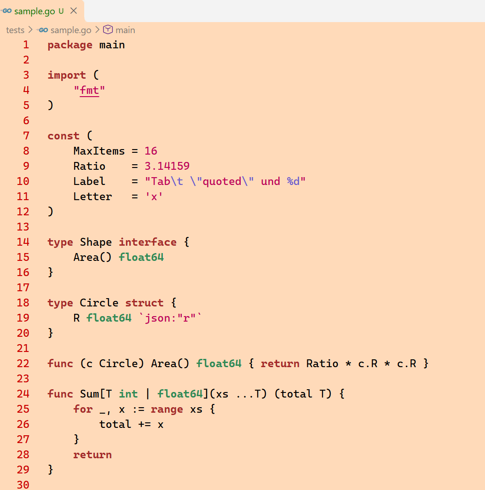

# Peachpuff (Vim Port)


A bright, elegant, and nostalgic **color theme for VS Code and VSCodium**,
faithfully ported from the classic **Vim “Peachpuff”** scheme — originally authored by *David Nečas (Yeti)* and later maintained within Vim’s runtime.
Perfect for users who enjoy a soft light background with warm contrast and a vintage charm.

<p align="center">

</p>

---

## ✨ Features


* Faithful recreation of the original **Vim Peachpuff** colors, read from Vim 9.1 (`:highlight`)
* Gentle peach background (`#FFDAB9`) ideal for long coding sessions
* Clear syntax contrast for Python, Markdown, HTML, and more
* Warm, balanced tones for eyestrain-free readability
* Vintage aesthetic with a modern touch


---


## 🧩 Installation


Works with **Visual Studio Code** and **VSCodium**. You can install **Peachpuff (Vim Port)** in two ways:


### 1. From the Extensions view


Search for:


> **Peachpuff (Vim Port)** by **r11s**


or open the page directly:

* VS Code: 👉 https://marketplace.visualstudio.com/items?itemName=r11s.peachpuff
* VSCodium: 👉 https://open-vsx.org/extension/r11s/peachpuff


### 2. Manual Installation (Local VSIX)

If you have downloaded the `.vsix` file manually (for example from your build output):

1. Open the **Command Palette** (`Ctrl+Shift+P` / `Cmd+Shift+P`).
2. Run `Extensions: Install from VSIX...`.
3. Select the `.vsix` file you built locally — done!


---


## 🖌️ Color Highlights

The colors are those of Vim’s `peachpuff.vim`. Vim names the groups; the theme maps TextMate scopes onto them.

| Vim group (style)  | Color     | Examples                                  |
|--------------------|-----------|-------------------------------------------|
| **Normal**         | `#000000` on `#FFDAB9` | text, operators, brackets, function names |
| **Statement** bold | `#A52A2A` | `if`, `for`, `func`, `return`             |
| **Constant**       | `#C00058` | strings, numbers, `true`                  |
| **Special**        | `#6A5ACD` | escapes such as `\t`, placeholders `%d`   |
| **Type** bold      | `#2E8B57` | `int`, `float64`, `public`, `static`      |
| **Identifier**     | `#008B8B` | built-ins such as `make`, `len`           |
| **PreProc**        | `#CD00CD` | Python `import`, `@Override`, `#include`  |
| **Comment**        | `#406090` | comments (not italic, as in Vim)          |

Further editor colors: current line `#F5C195`, selection `#CCCCCC`, line numbers `#CD0000`. Indent guides and word highlighting are switched off, as in Vim. Brackets stay uncolored, as in Vim. When the cursor is next to a bracket, the matching pair gets a `#6A5ACD` box with a faint tint of the same color behind it.

### Differences from gVim

Go, Java and Python were compared token by token with gVim; Go matches completely. What remains different:

* Java: Vim colors the first sentence of a Javadoc comment like a special (`#6A5ACD`). Unicode escapes such as `\u00e9` are only partly recognized by the TextMate grammar.
* Python: Vim colors a few names such as `None` in a function signature differently.
* JavaScript: Vim paints curly braces teal. This theme keeps them plain.
* C, JavaScript and Ruby were checked only roughly. Ruby follows the generic rules and differs from Vim in several places (for example `def` and `end`).
* If you have set `"editor.semanticHighlighting.enabled": true`, a language server such as gopls restyles operators, types and functions, and the colors no longer match Vim. By default it is off for this theme. Set it to `false` to see the real theme colors.

---

## ⚙️ Recommended settings

One setting matters for this theme. Everything else (indent guides, word highlighting, bracket colors) is already handled by the theme itself.

```jsonc
{
  // Use the theme
  "workbench.colorTheme": "Peachpuff (Vim Port)",

  // Keep language servers (gopls, etc.) from restyling tokens.
  // With "true" operators, types and functions get colors that Vim does not use.
  "editor.semanticHighlighting.enabled": false
}
```

**What is semantic highlighting?** VS Code and VSCodium color code in two steps. First the theme’s text patterns (TextMate scopes) color keywords, strings and so on, like Vim’s syntax files do. On top of that, a language server (gopls for Go, Pylance for Python, the Java and Kotlin extensions) can report what each name really is, such as a type, a parameter or a function, and VS Code colors it accordingly. That is more precise, but these colors replace the ones from the theme’s patterns. Vim has no such step, so Peachpuff is built without it. By default it is off for this theme. It is only active if you have set `"editor.semanticHighlighting.enabled": true` yourself, and then it applies to all themes.

---

## 🎛 Customizing

Every color can be changed without editing the theme:

```jsonc
"editor.tokenColorCustomizations": {
  "[Peachpuff (Vim Port)]": {
    "comments": "#355580",
    "strings": "#b00050"
  }
},
"workbench.colorCustomizations": {
  "[Peachpuff (Vim Port)]": {
    "editor.background": "#ffe0bf"
  }
}
```

In the Command Palette, **Developer: Inspect Editor Tokens and Scopes** shows which scope or color applies to the text under the cursor.

---

## 🧪 Test files

The repository contains short sample files in `tests/` (about 40 lines each) so you can check the theme in your own languages: Java, Go, Python, Ruby, C, C++, JavaScript, Kotlin, Pascal, COBOL, HTML (with CSS and JavaScript) and XML. Each file uses the same elements: comments, numbers, strings with escapes, type and function declarations, control flow and constants.

* VS Code and VSCodium have no built-in grammar for Kotlin, Pascal and COBOL. Install an extension that provides one, otherwise these files show as plain text:

  | Language | Extension ID              | Provides                              |
  |----------|---------------------------|---------------------------------------|
  | Kotlin   | `mathiasfrohlich.Kotlin`  | syntax highlighting only              |
  | Kotlin   | `JetBrains.kotlin-server` | language server (Kotlin by JetBrains) |
  | Pascal   | `alefragnani.pascal`      | syntax highlighting                   |
  | COBOL    | `bitlang.cobol`           | syntax highlighting                   |

  The colors in these languages depend on the scopes the extension’s grammar provides. On VSCodium the extensions are available only if they are published on Open VSX.

---

## 📝 Changes

### 1.1.0

* Rebuilt from Vim 9.1’s `peachpuff.vim`: syntax colors now follow Vim’s highlight groups. Go matches gVim token by token.
* Brackets stay uncolored; the matching bracket gets a `#6A5ACD` box with a faint tint behind it.
* Indent guides and word highlighting are switched off, as in Vim.
* Sample files for twelve languages added in `tests/`.
* README: color table, differences from gVim, customizing, notes on VSCodium and semantic highlighting.

---

## 🧠 About the Original


> The original *Peachpuff* color scheme was authored by **David Nečas (Yeti)**.
> This port for VS Code and VSCodium preserves its gentle, warm appearance while adapting it to modern editors and displays.


Acknowledgement: **Bram Moolenaar** is the creator of Vim.


Ported and adapted by **Rainer S. (r11s)**.


👉 https://www.vim.org/iccf/
